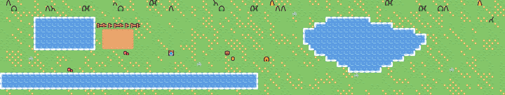

# 卷轴地图技术与 Kenney tileset 调研(票 #26)

> 调研票产出,供「世界探索改造」导航图(票 #25)后续布局票/实现票取用。
> 调研日期:2026-11-26。分支 `research/tilemap-assets`,基于 main(a048f04)。
> 术语见仓库 `GLOSSARY.md`;渲染约束见 `docs/adr/0001`、`docs/adr/0002`。

## TL;DR(三条结论)

1. **实现方案**:推荐「Tiled 兼容 JSON 数据 + 自写薄渲染器(逐 tile Sprite + 视口剔除)」;
   `@pixi/tilemap` 5.0.2 已官方支持 PixiJS v8,可作为性能后备预案,但本项目规模用不上,不建议现在引入;
   纯 TilingSprite 拼地图只适合矩形水体,不规则湖岸会把手写拼接逻辑推到不可维护。
2. **Kenney 素材**:Tiny Town / Tiny Farm 实盘下载核实——均 16×16、132 tile、CC0、v1.0(2026-07 重打包);
   草地底、装饰、成套建筑充足,**两者都无水面地形件与岸线件**;水面动画继续用现有 OGA 素材补位,
   已拼样例图验证「草地 + 三条水岸 + 装饰」组合成立(见下图)。
3. **数据格式**:地图定义推荐 Tiled 兼容 JSON(正交、CSV 层编码、单 tileset、含物件层),文件入库 +
   纯函数解析器 + 测试钉红线;行字符串常量表为轻量备选;base64/压缩编码与纯代码逐 tile 常量不推荐。

## 样例图:草地 + 三条水岸 + 装饰(Kenney 草/装饰 + 现有 OGA 水/泡沫)



- 左:池塘(矩形,对应「池塘」水域);下:河流(横带);右:湖(不规则 blob)。
- 草地基底 = Tiny Town tile_0000-0002;树/围栏/泥地/井/路标/金币 = Tiny Town;
  水面 = 现有 `public/sprites/water-flow.png`(13 帧流水,取帧 0);岸线泡沫 = 现有
  `public/sprites/shoreline-waves.png`(8 帧 × 4 边,取帧 0,按 `pondScene.buildWaveRing` 同款偏移贴边)。
- 结论:**组合可行,无需新增第三方水素材**。斜向湖岸的泡沫呈阶梯状(见样例图右),
  需要更顺滑的斜岸时启用 Zabin 原件 CURVE 拐角件(已在 `public/sprites/oga-src/`,未启用)。

---

## 一、实现方案对比

### 约束回顾

- 视口 480×270 逻辑分辨率 = **30×17 tile**(16×16 基线,ADR-0002;整数倍信箱缩放)。
- ADR-0001:只用 PixiJS 渲染,不引入 Phaser 类全家桶;ADR-0002:场景精灵化。
- 大地图规模(票面):3~6 屏宽。按 90~180 tile 宽、17~24 tile 高估算:
  - 单层 cell:90×17 = **1 530** ~ 180×24 = **4 320**;
  - 按 3 层(地面/水/装饰)总共 **4.6k ~ 13k** tile;
  - 每帧实际可见:30×17 × 3 层 ≈ **1.5k quad**——共享一张 base texture 时是一两个 draw call 的事。
  - **性能在这个规模下不构成选型依据**,真正依据是可维护性、不规则水域表达力、动画承接方式与依赖风险。

### 对比表

| | A. 手写 TilingSprite + 精灵拼图(现状延伸) | B. Tiled JSON + 自写薄渲染器 | C. `@pixi/tilemap` | D. Tiled 加载库(pixi-tiled 系) |
| --- | --- | --- | --- | --- |
| 新依赖 | 无 | 无(自写 ~100 行) | `@pixi/tilemap` 5.0.2(MIT,peerDep pixi.js ≥8.5.0) | 见下,与本项目均不匹配 |
| 数据形态 | 代码常量(矩形/区域参数) | Tiled 兼容 JSON 文件 | 任意(自己解析后喂 `tile()`) | Tiled 原生格式 |
| 不规则水域(湖) | 差:TilingSprite 只适合矩形;不规则岸线要退化成逐 tile Sprite,等于手搓半个 tilemap | 好:编辑器里画,数据如实表达 | 好 | 好 |
| 水面/岸线动画 | 好(现架构:帧轮换 + 逐 tile 相位环流) | 好:动画不入地图数据,渲染层按「水 cell 邻接」现算(现有 buildWaveRing 推广) | 受限:tile 动画共享单一全局时钟(animX/animY/animDivisor),岸线泡沫的逐 tile 相位做不了,仍需精灵层 | 依库而定 |
| 性能 | 好 | 好(可见 ~1.5k 精灵,共享 base texture 合批) | 最优(一次构建静态几何,draw call 最少,内建剔除) | 依库而定 |
| 可维护性 | 地图长大即失控(逻辑即数据,无编辑器) | 好:可视化编辑(Tiled 免费)+ JSON 可 diff 可评审 | 好,但多一层依赖心智 | 理论最好,实际取决于库活跃度 |
| 测试友好 | 好(纯数据) | 好:解析器纯函数 + 不变量测试 | 中 | 中 |
| 风险 | 低 | 低(无运行时依赖,格式自控) | 低-中(官方 userland 维护,活跃;2025-07 仍发版) | 高(见下) |

### 各方案事实核查(2026-11-26)

- **C `@pixi/tilemap`**:npm dist-tags latest **5.0.2(2025-07-14)**,MIT,peerDependencies `pixi.js >=8.5.0`
  (本项目 `pixi.js ^8.6.6` 满足);仓库 `pixijs-userland/tilemap`(330 stars,未归档),版本表明确
  v8.x → v5.x;`CompositeTilemap` 自动分片绕过单 tilemap 16k tile 上限;WebGL/WebGPU 双适配器 +
  canvas fallback。**注意**:其 tile 动画是 RPGMaker 式「整条 tilemap 一个时钟」
  (animX/animY/animCountX/animDivisor),表达不了现有岸线泡沫的逐 tile 相位环流。
- **D 候选逐一否决**:`pixi-tiled` 1.2.1(2016-01,peerDep pixi.js ^3)已死;
  `@fablevision/pixi-tiled` 3.0.0(2026-02,peerDep @pixi/* ^7.2.4)只到 Pixi v7;
  `pixi-tiledmap` 2.11.1(riebel,2026-11-20,peerDep pixi.js **≥8.10.0**)与本项目 ^8.6.6 不匹配
  (需先升 Pixi),且带 runtime editing 等用不上的重功能,单维护者。
- **A**:现状 `pondScene` 已是此形态(bankTiling 草地 + waterTiling 矩形水 + 逐 tile 泡沫精灵)。
  一片矩形水域一个 TilingSprite 很舒服;但「湖」这类不规则形会让 A 退化成逐 tile 手拼——
  而那正是 B 已经解决的问题。A 仍保留价值:同质底纹(整屏草地底)与矩形水体继续用 TilingSprite。

### 推荐

**B 为主路,C 为后备,A 局部保留**:

1. 地图数据用 Tiled 兼容 JSON(见第三节),渲染侧自写薄渲染器:
   从 packed 表切 tile(`textures.ts` 既有切片管线延伸)→ 逐 tile Sprite + 视口列剔除 →
   共享 base texture 自动合批。规模内毫无压力,零新运行时依赖,完全符合 ADR-0001/0002。
2. 若日后地图规模/复杂度暴涨(profiling 说需要),渲染器可平换 `@pixi/tilemap`:
   数据层不变(解析结果喂 `tile()` 即可),这是**渲染层内部替换**,不锁死选型。
3. 现有池塘场景不必立即重写:整屏草地底与矩形水面继续 TilingSprite,新世界地图按 B 落地,
   渐进收编。

---

## 二、Kenney Tiny Farm / Tiny Town 实盘

### 下载留痕(2026-11-26)

沿用 `public/sfx/README.md` 的 Kenney 签名直链技巧(会话 + Referer/XHR 头):

```
hex("assets/<slug>") → GET https://kenney.nl/download-link/<hex>
  (Header: Referer: https://kenney.nl/assets/<slug>, X-Requested-With: XMLHttpRequest)
→ {"url":"https://kenney.nl/download/<hex>/<sha256>?expires=..."} → 直链下载
```

- `kenney_tiny-farm.zip`(191 KB)、`kenney_tiny-town.zip`(182 KB)。
- 两包随包 `License.txt` 均声明 **CC0 1.0**;版本 **Tiny Farm 1.0 / Tiny Town 1.0**,
  创建日期 01-07-2026(2026-07 重打包,含两处对导航图 Notes 的勘误,见缺口清单)。
- 包结构:`Tilemap/tilemap_packed.png`(192×176,**12 列 × 11 行**,无间隔)、
  `Tilemap/tilemap.png`(203×186,1px 间隔版)、`Tiles/tile_0000..0131.png`(单件)。
  **tile 编号为行优先**:tile_N = packed 表 (N÷12, N%12)——已逐件比对核实。
- Tiled 直接可用:`tilemap_packed.png` 作为单图 tileset(16×16,12 列)导入即可。

### 盘点表

两包各 132 tile,16×16,CC0。按目检归类(个别 tile 归属可能差 1~2 个):

| 类别 | Tiny Town(枚举为 tile 编号) | Tiny Farm |
| --- | --- | --- |
| 草地基底(整块) | **0000-0002**(3 种平草,含花点缀)——推荐作世界基底 | 0105-0107(纯草块,另有压暗先例可复用) |
| 土路/泥地块 | 3×3 圆角块 0012-0014/0024-0026/0036-0038 + 单边镶草边 0039-0042 + 石草 0043(共 13) | 圆角土块 0000-0001/0012-0013、竖路 0024-0025/0036-0037、横路 0048-0051/0060-0063(共 12) |
| 草地坡/楔形件 | — | 三角坡 0093-0095、0117-0119,切角件 0129-0131(共 12,四角透明已核实) |
| 树木/灌木 | 单棵 0003-0005、0007-0008、0015-0016、0027-0028 + **双宽拼合件** 0009-0011/0018-0023/0030-0035(≈21)+ 蘑菇 0029、芽 0017 | 枯树/松 0002-0003/0014-0015/0026-0027、灌木球 0038、浆果丛 0078(≈8) |
| 围栏/桩柱 | 0044-0047、0056/0058-0059、0068-0071、0080-0082(≈13,横杆/立柱/T 接齐全) | 无(样例图中的围栏件实出自 Tiny Town) |
| 建筑 | **成套房屋**:蓝顶 0048-0051/0060-0063、红顶 0052-0055/0064-0067,木墙 0072-0075、石墙 0076-0079,门 0084-0091,拱门/石台 0096-0114、0123-0126(≈40) | 谷仓红墙/门/窗 0090-0092/0102-0104/0114-0116/0126-0128(12)+ 凳 0098-0101 |
| 物件/道具 | 井水台 0104、水桶 0131、梯 0103、金币 0093、干草 0094、靶标 0095、袋/钩 0105-0107、工具 0115-0119/0127-0129、路标 0083、土堆 0092(≈20) | 种子袋/板条箱 18(6 种作物 × 3)、农具 0084-0089、井 0072-0073、食槽 0074-0075/0110-0113、奶桶/篮/蛋 0123-0125 |
| 作物 | 无 | 胡萝卜/茄子/玉米/番茄/卷心菜/小麦 全套苗-株-果(≈26)+ 向日葵 0083 |
| 动物 | 无 | 鸡 0079/0122、绵羊 0120、奶牛 0121 |
| 角色 | 无 | **2 个静态农夫** 0108/0109(v1.0 新增;单帧立绘,无行走动画) |
| **水面地形件** | **无**(仅井台/水桶等「含水物件」) | **无**(同左:井 0073、水槽 0110-0111 含水,均为物件) |
| **岸线/水岸过渡件** | **无**(草↔土过渡有,草↔水无) | **无** |

### 「草地 + 三条水岸 + 装饰」拼图评估

- **草地**:两包都有整块平草;Tiny Town 0000-0002 三连最干净,推荐做基底,Farm 草作农田区变体。
- **三条水岸(池塘/河流/湖)**:Kenney 侧**零支持**——无水面、无水岸过渡;水面与岸线全部沿用现有
  OGA 素材(`water-flow.png` 13 帧流水 + `shoreline-waves.png` 8 帧 × 4 边泡沫)。
  样例图(本文开头)按 `pondScene.buildWaveRing` 同款偏移(土侧 6px 朝外)贴边,**四边及阶梯状
  湖岸均成立**。
- **装饰**:充足且两包调色一致(Kenney Tiny 系同族);样例图中树/围栏/泥地/井/路标/金币混排无违和。
- **商店摊位**:Tiny Town 成套房屋(顶/墙/门/拱门)可拼出摊位立面,或待布局票定形态。
- **调色衔接**:OGA 水件与 Kenney 草件在样例图中共处无明显撞色;注意现有 `grass.png` 是
  「压暗 0.78」派生(原因:荧光绿刺眼 + HUD 文字可读性,sprites README),换 Kenney 草后底色变亮,
  **落地票需复检 HUD 文本对比度**(必要时对 Kenney 草沿用同款压暗派生)。

### 缺口清单

| 缺口 | 现状 | 补位方案 | 结论 |
| --- | --- | --- | --- |
| 水面动画件 | Kenney 两包均无 | 现有 OGA `water-flow.png`(13 帧,已入库, ponds 在用) | **无缺口**,沿用 |
| 岸线泡沫动画 | Kenney 无 | 现有 OGA `shoreline-waves.png`(8 帧 × 4 边,已入库) | **无缺口**,沿用 |
| 斜向/拐角岸线 | 现用直边泡沫贴片,斜岸呈阶梯 | Zabin 原件 CURVE 拐角件(16×32 双排)**已在 `public/sprites/oga-src/` 未启用**,湖岸需要时接 | 有预案,不必新增素材 |
| 草↔水过渡带 | 无(靠描边 + 泡沫) | 维持现状;Kenney 只有草↔土过渡(0039-0042) | 接受现状,布局票验体感 |
| 角色行走动画 | Farm 农夫为静态单帧 | 现有 OGA `character.png`(16×16 四向 4 帧) | **无缺口**,沿用 |
| 水中生物/码头等水畔设施 | 两包皆无 | 待布局票定需求再找 CC0;或自绘图集(有 generate-*-atlas 脚本先例) | 记入导航图 Not yet specified |

### 对导航图 Notes 的两处勘误(供主线更新图时取用)

1. 「(Tiny Farm)**无角色**」已过时:v1.0(2026-07 重打包)含 2 个**静态**农夫 tile;
   但行走动画角色仍应沿用现有 OGA character.png(Kenney 无动画帧)。
2. 「无水面」仍然成立,但精确化:指**无水面地形件/岸线件**;井(0073)、水槽(0110-0111)、
   井水台(Town 0104)、水桶(Town 0131)为含水物件,不解决水域渲染。

---

## 三、大地图数据格式建议

### 候选形态

| 形态 | 评价 |
| --- | --- |
| **Tiled 兼容 JSON 文件**(推荐) | 可视化编辑 + 可 diff + 可评审 + 解析器纯函数化;Tiled 免费,packed 表直接作 tileset |
| 行字符串常量表(每行一个字符串,图例映射) | 零工具、可读性最好、diff 最友好;17~24 行 × 90~180 字符尚可读;但无编辑器,装饰/物件层多时维护成本陡增;**轻量备选** |
| base64(+gzip/zlib)编码 | 不可 diff、不可评审,本规模毫无收益;**不推荐** |
| 纯代码逐 tile 常量 | 1.5k~4k 个数字写进 TS 不可读不可审,违背仓库「纯数据表」先例的精神(waterAreas/fishCatalog 是语义表,不是逐格矩阵);**不推荐** |

### 推荐格式细则(Tiled JSON)

- **正交(orthogonal)+ right-down**,`tilewidth/tileheight = 16`,地图 90~180 × 17~24 tile。
- **单 tileset**:`tilemap_packed.png`,12 列,`firstgid: 1`。多包(如加 Tiny Farm 物件)就
  多 tileset 条目,解析器按 `firstgid` 区间路由。
- **层编码 CSV**(不要 base64):PR diff 可读、可逐行评审;1.5k~4k 数字/层完全可接受。
- **图层语义**(建议 4 层):
  1. `ground`——草地/土路基底;
  2. `water`——水域 cell(渲染层据此铺 OGA 流水动画 + 由邻接现算泡沫环,**动画不入数据**);
  3. `deco`——树/围栏/物件等装饰(可含 alpha 叠加);
  4. `objects`(object layer)——交互点:出生点、钓点锚、商店摊位、(未来)指路标记。
     用对象层而非 magic tile,坐标与语义解耦,交互系统票直接消费。
- **翻转位**:Tiled gid 高位存翻转——水平 `0x80000000`、垂直 `0x40000000`、斜翻 `0x20000000`
  (位 31/30/29),实际 tile id = `gid & 0x0FFFFFFF`。解析器**必须**先掩码再查表;与 Tiled 约定
  「地图制作期不用斜翻」可把渲染侧先简化到只处理 H/V(甚至约定都不用)。
- **文件位置**:`src/world/worldMap.json`,Vite JSON import(随包构建、免运行时 fetch、可被测试直接
  import),加载后过一道纯函数 `parseWorldMap()` 校验并归一化。
- **测试红线**(沿用仓库纪律):解析器为纯函数;测试钉死——层尺寸一致、gid 在 tileset 区间内、
  至少三片水域且与 `WATER_AREAS` id 对齐、视口 30×17 能在任意合法滚动位置完整取样、
  对象层引用的水域 id 存在。地图 JSON 改动 = 数据 diff,评审直观。

### 渲染侧备忘(给实现票)

- 切片:`textures.ts` 增加 packed 表切片入口(12 列网格,复用 `sliceGrid`);Kenney tile 与
  OGA tile 不同 source,**不强行并成一张图集**,按 source 分组渲染即可(合批按 base texture 分)。
- 剔除:按 `scrollX/16` 起止列渲染,每帧 ≤ 30×17×层数 个精灵;无需 chunk。
- 帧动画:水面/泡沫沿用「纹理数组 + 时间轮换」现状;泡沫环由 `water` 层邻接计算
  (推广 `buildWaveRing`,不再假设矩形)。
- 摄像机:横版卷轴,世界像素宽 = 宽 tile × 16;边界钳制即可,无需 `pixi-viewport`。

---

## 附:本次调研产出的可复用事实

- Kenney 签名直链技巧对资产包(非音效包)同样有效(上文下载留痕)。
- `tilemap_packed.png` 行优先编号规则、两包逐 tile 盘点(见盘点表)可直接作为后续
  「tile id → 语义」映射表的起点。
- 样例图生成脚本(研究过程件,不入库):`PIL` 拼装,验证了 OGA 泡沫四向偏移公式
  (top y-6 / bottom y+6 / left x-6 / right x+6,即 `pondScene.buildWaveRing` 的逐 tile 推广)。

## 参考链接

- Kenney: <https://kenney.nl/assets/tiny-farm> / <https://kenney.nl/assets/tiny-town>(CC0)
- `@pixi/tilemap`: <https://github.com/pixijs-userland/tilemap>(npm 5.0.2,2025-07-14,MIT,
  peerDep pixi.js ≥8.5.0)
- Tiled 格式:<https://doc.mapeditor.org/en/stable/reference/tmx-map-format/> 与
  <https://doc.mapeditor.org/en/stable/reference/global-tile-ids/>(flip 位)
- 本仓库既有素材溯源:`THIRD-PARTY-NOTICES.md`、`public/sprites/README.md`、`public/sfx/README.md`
